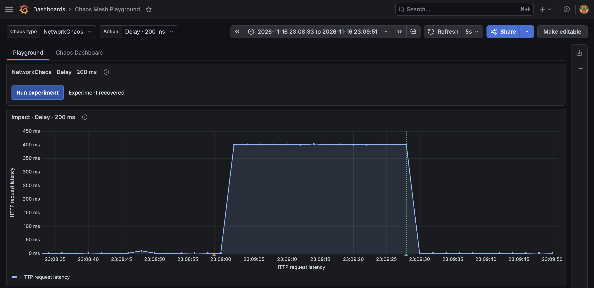

# Chaos Mesh Playground

Chaos Mesh Playground is a local demo for exploring how Kubernetes workloads respond to failures. In Grafana, you can run preset Chaos Mesh experiments and see workload metrics alongside injection and recovery events.



## Run the demo

Run the commands from the Playground repository root in Bash or Zsh. Install Git, Docker, Minikube, kubectl, and Helm. The daemon build requires BuildKit with Dockerfile frontend 1.6 or later for `ADD --checksum`.

These steps use a dedicated Minikube cluster with containerd, Linux netem and FUSE, and cgroup v2. If you use a different profile, substitute its name for `minikube` in the commands below.

```sh
minikube start -p minikube --keep-context --driver=docker \
  --container-runtime=containerd --kubernetes-version=v1.37.0 --cpus=2 --memory=3600
```

The demo uses [Chaos Mesh v2.8.8](https://github.com/chaos-mesh/chaos-mesh/releases/tag/v2.8.8). The demo's daemon image includes a native [toda binary](https://github.com/chaos-mesh/toda/commit/75e58ca74e259fff7a14a48d29f17daa563fdd74) for IOChaos and [chaos-tproxy v0.6.0](https://github.com/chaos-mesh/chaos-tproxy/releases/tag/v0.6.0) for HTTPChaos recovery. The DNSChaos static preset stays out of the demo until a release supports it.

Fetch the pinned `toda` commit, then build and load the daemon image for the Minikube node.

```sh
(
  set -e -o pipefail
  work_dir=$(mktemp -d)
  trap 'rm -r "$work_dir"' EXIT
  git init --quiet "$work_dir/toda"
  git -C "$work_dir/toda" fetch --depth=1 https://github.com/chaos-mesh/toda.git \
    75e58ca74e259fff7a14a48d29f17daa563fdd74
  mkdir "$work_dir/build"
  git -C "$work_dir/toda" archive FETCH_HEAD | tar -x -C "$work_dir/build"
  node_arch=$(kubectl --context minikube get nodes -o jsonpath='{.items[0].status.nodeInfo.architecture}')
  docker build --platform "linux/$node_arch" -f deploy/chaos-daemon.Dockerfile \
    -t playground/chaos-daemon:2.8.8-toda-tproxy "$work_dir/build"
  minikube -p minikube image load playground/chaos-daemon:2.8.8-toda-tproxy
)
```

Fetch the chart from the Chaos Mesh `v2.8.8` tag and install it.

```sh
(
  set -e -o pipefail
  work_dir=$(mktemp -d)
  trap 'rm -r "$work_dir"' EXIT
  git init --quiet "$work_dir/chaos-mesh"
  git -C "$work_dir/chaos-mesh" fetch --depth=1 https://github.com/chaos-mesh/chaos-mesh.git \
    refs/tags/v2.8.8
  git -C "$work_dir/chaos-mesh" archive FETCH_HEAD helm/chaos-mesh | tar -x -C "$work_dir"
  helm install playground-chaos "$work_dir/helm/chaos-mesh" \
    --kube-context minikube --namespace playground-chaos --create-namespace \
    -f deploy/chaos-mesh-values.yaml --wait
)
```

Create the Grafana password once and deploy the demo.

```sh
kubectl --context minikube apply -f deploy/namespace.yaml
kubectl --context minikube -n playground-demo create secret generic grafana-admin \
  --from-literal=password="$(openssl rand -hex 18)"
kubectl --context minikube apply -k .
kubectl --context minikube -n playground-demo wait --for=condition=Available deployment --all --timeout=180s
kubectl --context minikube -n playground-demo port-forward svc/grafana 3300:8080
```

Open [Chaos Mesh Playground](http://127.0.0.1:3300/d/chaos-mesh-playground/chaos-mesh-playground) and sign in as `admin`. Read the password from the `grafana-admin` secret.

```sh
kubectl --context minikube -n playground-demo get secret grafana-admin \
  -o jsonpath='{.data.password}' | base64 -d
```

Choose **Chaos type**, then **Action**. The **Impact** chart switches to the measurement for the selected case.

| Chaos | Action | Measurement |
| --- | --- | --- |
| DNSChaos | error | DNS lookup failures |
| | random | DNS answers that differ from the Service IP |
| HTTPChaos | abort | HTTP response failures |
| | delay | HTTP response latency |
| | patch | Patched response header |
| | replace | Replaced JSON response body |
| IOChaos | attrOverride | Test file permissions in octal |
| | fault | Read error rate |
| | latency | Test file read latency |
| | mistake | Read content mismatch rate |
| JVMChaos | exception | Java method failures |
| | gc | Recent JVM garbage collections and collection time |
| | latency | Java method execution time |
| | return | Java method return value |
| | ruleData | Return values for matching and nonmatching inputs |
| | stress | CPU cores used by the JVM |
| NetworkChaos | bandwidth | Received UDP payload throughput |
| | corrupt | UDP payload checksum errors |
| | delay | HTTP request latency |
| | duplicate | Duplicate UDP packets |
| | loss | Missing UDP sequence numbers |
| | netem | UDP one-way delay and packet loss |
| | partition | UDP reachability |
| PodChaos | container-kill | Restarts of the target container |
| | pod-failure | HTTP probe success |
| | pod-kill | Ready state of the old and replacement Pods |
| StressChaos | CPU | CPU cores used by the target container |
| | memory | Anonymous memory used by the target container |
| TimeChaos | clock skew | Real-time clock offset from the Prometheus scrape time |

Wait for a few baseline samples and click **Run experiment**. You can run one case at a time. The button is disabled while an experiment is starting, running, or recovering. Click **Cancel** while the experiment is starting. Starting an experiment switches a historical time range to the last five minutes with live refresh.

While a timed case is running, click **Pause** to recover the workload. Once recovery finishes, you can run another preset. To resume the paused experiment, select it and click **Start** before the original 30-second deadline. **Start** is available after recovery while no other experiment is active. To end a running timed experiment early, click **Stop**. For Pod kill and container kill, wait for **Workload Ready** while Kubernetes restores the Deployment.

IOChaos is scoped to a test file on an `emptyDir`. UDP cases send traffic between two demo Pods. The sender attaches an application checksum so the probe can measure corruption in received UDP payloads.

TimeChaos shifts the probe's real-time clock forward by 60 seconds. The offset returns to about zero after recovery.

JVMChaos uses the existing Java 17 probe. The return preset changes `probeValue()` from 7 to 99 and restores it to 7. Latency adds 300 milliseconds to that method. The exception preset throws `IllegalStateException` from the method while the metrics endpoint stays available. The conditional `ruleData` preset changes `ruleValue(7)` to 42 and leaves `ruleValue(8)` at 8.

The GC preset requests one garbage collection when the agent installs the rule. The chart estimates the collection count and total collection time over the last 10 seconds. The stress preset starts one CPU worker. Removing the rule stops the worker. The chart shows the CPU cores used by the Java process.

Grafana filters event markers to the selected preset and identifies every run by UID. **Chaos Mesh recovered** marks the controller event. **Workload Ready** comes from the replacement Pod or restarted container observed through the Kubernetes API. Prometheus retains samples for up to 15 days. It has no persistent volume, so recreating the Pod clears the sample history. The runner keeps up to 100 prior runs in memory.

Open the **Chaos Dashboard** tab to inspect the current run of the selected preset. Its gateway requires a Grafana session and allows read requests. The Dashboard service account can only read resources in `playground-demo`. The dedicated local Grafana instance enables HTML in provisioned text panels to embed the original Dashboard.


## Remove the demo

Stop port-forwarding and delete the demo namespace. Remove the Chaos Mesh release only if you installed it for this demo.

```sh
kubectl --context minikube delete namespace playground-demo
helm uninstall playground-chaos --kube-context minikube --namespace playground-chaos
```

Helm leaves the `playground-chaos` namespace and the Chaos Mesh CRDs in the cluster. To remove the entire cluster, delete the Minikube profile you created exclusively for this demo. This deletes all workloads and data in that profile.

```sh
minikube delete -p minikube
```
